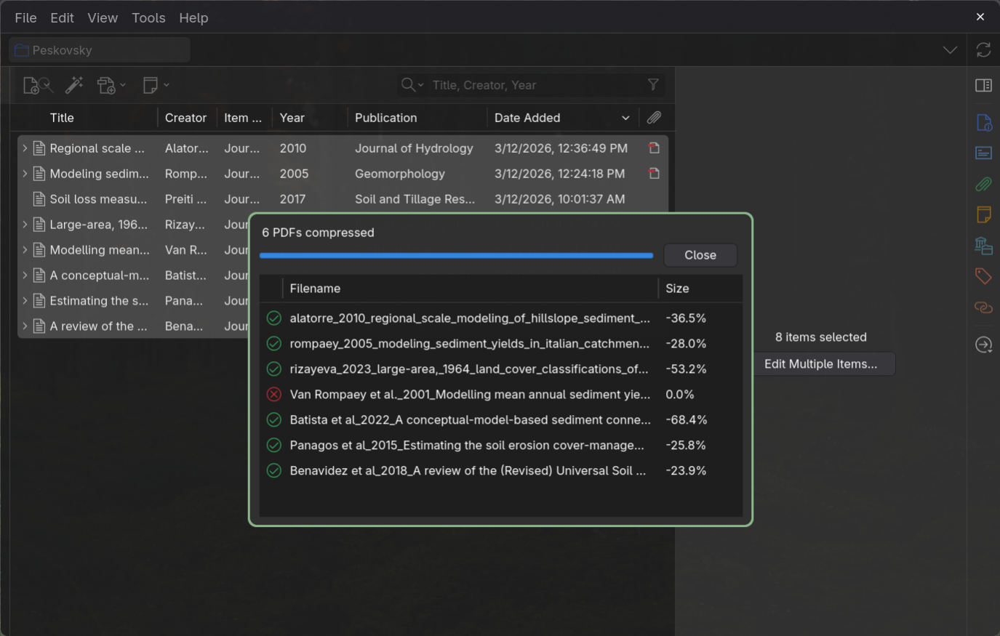

# MuPDF Compress for Zotero

[](LICENSE)
[](https://github.com/atsyplenkov/zotero-mupdf-compress/releases/latest)
[](https://github.com/atsyplenkov/zotero-mupdf-compress/releases)
[](https://www.zotero.org/)

MuPDF Compress is a [Zotero](https://www.zotero.org/) extension for reducing the
size of PDF attachments directly from your library. It uses a bundled
[MuPDF](https://mupdf.com/) engine to process files locally, without uploading them
to an external service.

Select your items, right-click, and choose **Compress PDF → Compress**. Review the
results and, if needed, use **Revert** to recover the original PDFs during the
same Zotero session.


## Features

- Compress individual PDFs or process multiple selected items in sequence.
- Work with both stored attachments and linked attachments.
- See the outcome and file-size reduction for each PDF.
- Replace an attachment only when the compressed output passes validation and is
  smaller.
- Keep a verified session backup so you can revert a successful compression before
  closing Zotero.

Compression uses fixed settings, including downsampling color and grayscale
images to 150 DPI and JPEG recompression at quality 85. **Image compression is
lossy:** inspect the results before discarding your originals. Savings depend on
the PDF; some files cannot be made smaller.

## Installation

> [!IMPORTANT]
> The current bundled engine is built for **Linux x86-64** and requires
> **glibc 2.43**. It is not a portable Linux build, and this release does not
> include Windows or macOS binaries.
>
> Tested with **Zotero 10.0.6**. The extension manifest allows Zotero 7–10.0.x,
> but earlier versions have not been tested.

1. Download `mu-pdf-compress.xpi` from the **Assets** section of the
   [latest release](https://github.com/atsyplenkov/zotero-mupdf-compress/releases/latest).
2. In Zotero, open **Tools → Plugins**.
3. Click the gear button, choose **Install Plugin From File…**, and select the
   downloaded `.xpi`.

If Firefox tries to install the file as a browser extension, right-click the
download link and choose **Save Link As…**.

After installation, Zotero can check for plugin updates. See the
[changelog](CHANGELOG.md) for release notes.

## Usage

### Compress PDFs

1. Close the PDFs you want to compress in Zotero’s reader.
2. Select PDF attachments or parent items in your library. Selecting a parent
   item includes its PDF attachments.
3. Right-click and choose **Compress PDF → Compress**.
4. Review the results window for each file’s outcome and size reduction.



Compression keeps the same Zotero attachment item and file path. Stored
attachments are marked for upload through Zotero file sync. Linked attachments
are changed at their existing location.

Encrypted PDFs are not processed. Files open in Zotero’s reader must be closed
before compression or Revert.

### Revert a compression

Select the attachment or its parent item, then choose **Compress PDF → Revert**
from the context menu.

Revert restores the original PDF from its session backup. If the attachment’s
path or contents have changed since compression, Revert is blocked to avoid
overwriting those changes.

> [!WARNING]
> Session backups are temporary. They are removed when Zotero quits or the
> extension shuts down, and Revert is not available after a restart, including
> after a crash. Keep separate backups of important files.

### Temporary folder

Open **Zotero Settings → MuPDF Compress** to choose where session backups are
stored.

Leave **Temporary folder** blank to use Zotero’s temporary directory, or choose
an existing writable folder. Changes take effect the next time Zotero starts;
the current session keeps using its original folder.

## Development

Install [mise](https://mise.jdx.dev/) and GNU Make first. Tool versions are
pinned in [`mise.toml`](mise.toml) and [`package.json`](package.json).
`make setup` installs the pinned tools and npm dependencies.

```sh
make setup
make build
```

The installable extension is written to `mu-pdf-compress_<version>.xpi` in the
repository root.

Run the same checks used by CI:

```sh
make test
```

This runs linting, type checking, tests, the build, and distribution checks.

### Stable releases

The release workflow accepts only canonical stable tags such as `v0.1.6`, with
no leading zeroes, prerelease suffix, or build metadata. The tag must match the
version in `package.json` and point to the checked-out commit. Annotated tags
are checked by their target commit.

That commit must already be in `main`'s history. The workflow fetches complete
Git history and checks ancestry against `origin/main`; missing main history or
a shallow checkout is rejected. Tags on unmerged branches are not eligible.
An older commit in main can still be released, provided no newer version has
already been published or offered in the update feed.

Pushing an eligible version tag starts the workflow. Creating a local tag
without pushing it does not start GitHub Actions. For a manual retry, select
the existing version tag, or a branch whose selected commit has that matching
tag. Manual dispatch does not create a version tag or bypass the version,
checked-out commit, or main-history checks.

Eligibility is checked before publication writes, including on retries.
Publication remains serialized. Once a version is public, its assets are not
replaced: a retry validates and reuses those assets to repair the update feed.
A successful eligibility check does not prove platform compatibility; the
Linux-only limitations described under Installation still apply.

## License

Licensed under [AGPL-3.0-or-later](LICENSE), without warranty. The bundled MuPDF
engine and its dependencies are covered by their respective
[licenses and notices](addon/THIRD-PARTY.md). See
[SOURCE.md](addon/SOURCE.md) for source code and build instructions.
