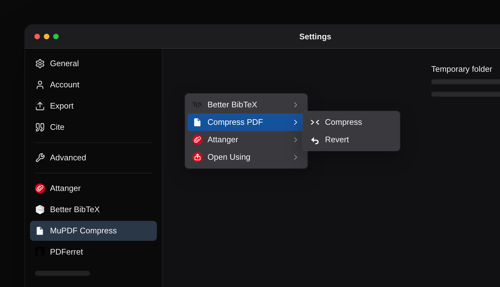

# MuPDF Compress for Zotero

AGPL-3.0-or-later Zotero extension that compresses the selected stored or
linked PDFs, one after another, with a bundled MuPDF engine. This checkout currently
implements the plugin lifecycle, the Settings pane (#11), the single-attachment
context menu and stored-PDF Compression (#12), linked-PDF Compression (#13), the
parent-item menu for a sole PDF (#14), Revert with shared-path ownership and
partial recovery (#17), the session backup folder, ownership, and cleanup (#16),
and the distribution material: license, notices, build recipe, build record, and
packaged source (#18). The bundled
engine in this checkout is the host build; `BUILD-RECORD.md` records its measured
runtime requirements, including the GLIBC_2.43 limitation. That is not an
approved portable baseline.

The manifest targets Zotero 7 and newer. Only Zotero 10.0.6 has been run so far.



## Build

Node 26.12.1 and npm 11.20.0 were used for the recorded build.

```sh
npm ci
npm run build
```

The XPI is `.scaffold/build/mu-pdf-compress.xpi`. The build uses
`zotero-plugin-scaffold` and TypeScript. The add-on ID is
`mupdf-compress@atsyplenkov.github.io`. The manifest update URL is a reserved
`example.invalid` placeholder; there is no automatic-update feed.

The XPI also carries the distribution material the license requires:

- `LICENSE`, `notices/`, and `THIRD-PARTY.md` for the project, MuPDF,
  third-party libraries, CMaps, fonts, and hyphenation patterns.
- `SOURCE.md` for the MuPDF 1.28.5 source pin, source access, and build
  instructions.
- `native/build-engine.sh` and `native/session-lock.c` for the native build.
- `BUILD-RECORD.md` for the measured toolchain, flags, digests, linkage, and
  symbol requirements.
- `source/` for the matching TypeScript and build configuration.

`scripts/check-distribution.py` checks those packaged contents and runs as part
of `mise run check`. Distributing an XPI also requires the verified
`mupdf-1.28.5-source.tar.gz` archive to be available from the same place as the
XPI; `SOURCE.md` states that requirement.

## Settings

Selecting MuPDF Compress in Zotero Settings shows one text field, Temporary
folder. A blank value means Zotero's temporary directory. The folder must already
exist and be writable. A change applies on the next Zotero launch; the current
session keeps its folder and backups. Session backups live in a private UUID
directory with an OS-held lock, and a normal close removes the current session
folder after any active operation finishes. No quality preset, retention
setting, or recovery override is offered.

## Layout

- `addon/` contains the bootstrap lifecycle, manifest, default preferences, the
  Settings pane markup, the progress window, the native binaries and their build
  recipe, and the distribution license and notice files.
- `src/` contains the TypeScript startup, main-window and pane registration, the
  context menu, target resolution, the attachment operation, the session
  backup/lock/lifecycle handling, and the bundled-engine runner.
- `scripts/check-distribution.py` checks the built XPI contents.
- `typings/` contains the sandbox globals and generated preference typing.
  `npm run build` regenerates `typings/prefs.d.ts` and an excluded
  `typings/i10n.d.ts`.

## Testing

The isolated-profile driver and host scripts are local under `.local-test/` and
are not committed. The recorded checks and their limits are in
[docs/testing/settings-and-lifecycle.md](docs/testing/settings-and-lifecycle.md),
[docs/testing/compress-one-stored-pdf.md](docs/testing/compress-one-stored-pdf.md),
[docs/testing/compress-one-linked-pdf.md](docs/testing/compress-one-linked-pdf.md),
[docs/testing/parent-item-menu.md](docs/testing/parent-item-menu.md),
[docs/testing/revert-a-compressed-attachment.md](docs/testing/revert-a-compressed-attachment.md),
[docs/testing/session-and-cleanup.md](docs/testing/session-and-cleanup.md), and
[docs/testing/distribution.md](docs/testing/distribution.md).

## License

AGPL-3.0-or-later. The XPI carries `LICENSE`, the MuPDF license, the
third-party, CMap, and font notices, the native build recipe, the measured build
record, and the matching extension source. See `SOURCE.md` in the XPI for
corresponding-source access.
